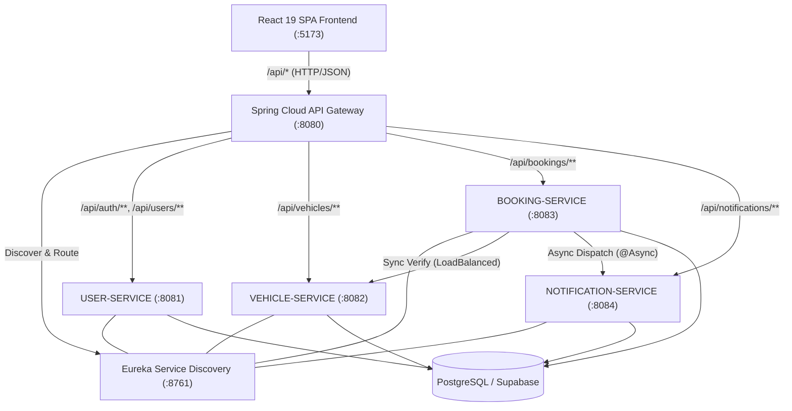

# VAYRO — Fleet Lifecycle & Vehicle Rental Management Platform

[](https://spring.io/projects/spring-boot)
[](https://www.oracle.com/java/)
[](https://react.dev/)
[](https://vitejs.dev/)
[](https://www.postgresql.org/)
[](https://www.docker.com/)
[](LICENSE)

---

## 1. Project Overview
**VAYRO** is a cloud-native, microservices-engineered vehicle rental and fleet lifecycle management platform. Designed for high concurrency, zero booking conflicts, and enterprise scalability, VAYRO integrates a reactive API Gateway, distributed service discovery, stateless JWT authentication, asynchronous invoice generation, and a modern single-page React frontend.

---

## 2. Problem Statement
Traditional car rental businesses and legacy booking platforms suffer from:
- **Distributed State Inconsistencies:** Concurrent booking attempts causing vehicle double-allocation.
- **Monolithic Bottlenecks:** A failure in payment or notification crashes catalog browsing and user login.
- **Opaque Pricing & Hidden Charges:** Lack of real-time GST tax breakdown, dynamic add-ons, and coupon calculation.
- **Manual Verification Delays:** Paper invoices and manual status updates instead of real-time PDF generation and instant email delivery.

---

## 3. Objectives
- **Zero-Overlap Guarantee:** Enforce rigorous mathematical interval overlap detection `[start, end)` at the database repository level.
- **Fault-Tolerant Microservices:** Decouple Authentication, Catalogue, Reservation, and Notifications via Spring Cloud Eureka and API Gateway.
- **Stateless & Secure Access:** Implement HMAC-SHA256 JWT security across all microservice boundaries.
- **Seamless User Experience:** Provide a responsive, high-performance UI featuring interactive 5-step booking and instant booking confirmation.

---

## 4. Key Features
- **207-Vehicle Multi-Category Catalogue:** Real-time search, category filtering (Cars, Luxury SUVs, Premium Motorcycles), and live status tracking.
- **Stateless RBAC Security:** Role-based access control distinguishing `USER` (customers) and `ADMIN` (fleet managers).
- **Automated Price Computation:** Real-time duration calculation, dynamic add-ons selection, promotional coupon discounts, and automated 18% GST tax application.
- **Asynchronous Invoice & Email Dispatch:** Dynamic PDF tax invoice generation via OpenPDF and non-blocking Gmail SMTP dispatch with idempotency protection.
- **Responsive Management Dashboards:** Dedicated Customer Booking Hub and Fleet Operations Admin Dashboard.

---

## 5. Digital Transformation & Innovation (DTI) Concepts
VAYRO directly embodies digital transformation principles:
- **Centralized Digital Platform:** Replaces fragmented paper and legacy manual bookings with a unified digital ecosystem.
- **Process Automation:** Automated end-to-end reservation workflow from date selection to payment simulation and invoice delivery.
- **Data-Driven Fleet Management:** Real-time visibility into vehicle maintenance, utilization rates, and active reservations.
- **Service Integration & Composability:** Independent microservices loosely coupled through standardized REST interfaces and Eureka Discovery.
- **Secure Digital Identity:** Zero-trust edge validation through reactive API Gateway token inspection.

---

## 6. System Architecture



---

## 7. Microservices Architecture

| Microservice | Port | Eureka Service ID | Responsibilities |
| :--- | :--- | :--- | :--- |
| **Eureka Server** | `8761` | `EUREKA-SERVER` | Central registry, heartbeat monitoring, and dynamic instance routing |
| **API Gateway** | `8080` | `API-GATEWAY` | Reactive reverse proxy, JWT edge verification, CORS enforcement, request routing |
| **User Service** | `8081` | `USER-SERVICE` | User accounts, BCrypt credential hashing, JWT token minting, Google OAuth |
| **Vehicle Service** | `8082` | `VEHICLE-SERVICE` | 207-vehicle catalog, dynamic specification search, fleet availability status |
| **Booking Service** | `8083` | `BOOKING-SERVICE` | Reservation lifecycle, date overlap prevention, pricing engine, tax calculation |
| **Notification Service** | `8084` | `NOTIFICATION-SERVICE` | Idempotent log auditing, OpenPDF tax invoice creation, asynchronous SMTP email |

---

## 8. Service Discovery with Eureka
Each Spring Boot microservice includes `spring-cloud-starter-netflix-eureka-client` and publishes its hostname and port metadata to the master Eureka registry on startup:
```yaml
eureka:
  client:
    service-url:
      defaultZone: ${EUREKA_SERVER_URL:http://localhost:8761/eureka/}
    register-with-eureka: true
    fetch-registry: true
```
Services communicate seamlessly using logical hostnames (`http://VEHICLE-SERVICE`, `http://NOTIFICATION-SERVICE`) resolved dynamically via `@LoadBalanced RestClient`.

---

## 9. JWT Authentication

### Authentication Flow:
1. **Login Request:** Client submits credentials (`POST /api/auth/login`) to API Gateway.
2. **Gateway Forwarding:** Gateway routes request to `USER-SERVICE`.
3. **Verification & Issuance:** `AuthService` verifies BCrypt password hash and `JwtService` issues an HMAC-SHA256 signed token containing `userId`, `role`, `name`, and expiration (`exp`).
4. **Client Session:** Frontend stores token in `localStorage` under `vayro_session`.
5. **Token Propagation:** Axios interceptor attaches `Authorization: Bearer <token>` to all protected calls.
6. **Edge & Downstream Validation:** Gateway and target services validate signature, verify expiration, and establish Spring Security `SecurityContext`.

---

## 10. API Gateway Routing
Spring Cloud Gateway provides non-blocking, reactive HTTP routing:
```yaml
spring:
  cloud:
    gateway:
      routes:
        - id: user-auth-route
          uri: lb://USER-SERVICE
          predicates:
            - Path=/api/auth/**
        - id: user-service-route
          uri: lb://USER-SERVICE
          predicates:
            - Path=/api/users/**
        - id: vehicle-service-route
          uri: lb://VEHICLE-SERVICE
          predicates:
            - Path=/api/vehicles/**
        - id: booking-service-route
          uri: lb://BOOKING-SERVICE
          predicates:
            - Path=/api/bookings/**
        - id: notification-service-route
          uri: lb://NOTIFICATION-SERVICE
          predicates:
            - Path=/api/notifications/**
```

---

## 11. Frontend Technology
- **Framework:** React 19 SPA client with React Router v7.
- **Build Tool:** Vite 6 with high-speed HMR and optimized asset bundling.
- **Styling:** Modern Tailwind CSS with custom glassmorphism, responsive grids, and micro-animations via Framer Motion.
- **Icons:** Lucide React.
- **Networking:** Axios with automated request/response interceptors for token injection and structured error extraction.

---

## 12. Backend Technology
- **Framework:** Spring Boot 3.4.3 & Spring Cloud 2024.0.0.
- **Language:** Java 21 LTS.
- **Security:** Spring Security 6, JJWT 0.12.6, BCrypt.
- **Data Persistence:** Spring Data JPA & Hibernate ORM with HikariCP connection pooling.
- **PDF Generation:** OpenPDF 2.0.3.
- **Mail:** Spring Boot Starter Mail (JavaMailSender / SMTP).

---

## 13. Database Architecture
- **Engine:** PostgreSQL 16 (Hosted on Supabase with connection pooling).
- **Core Entities:**
  - `User`: Account credentials, contact information, role (`USER` / `ADMIN`), timestamps.
  - `Vehicle`: Vehicle ID, brand, model, daily price, seating, fuel type, transmission, status (`AVAILABLE`, `RENTED`, `MAINTENANCE`).
  - `Booking`: Reference ID, user ID, vehicle ID, pickup/return dates, breakdown (base, addons, discount, tax, total), status (`CONFIRMED`, `ACTIVE`, `COMPLETED`, `CANCELLED`).
  - `Notification`: Audit logs, idempotency key, email delivery status (`PENDING`, `SENT`, `FAILED`).

---

## 14. Notification System & Invoice Generation
When a booking is confirmed:
1. `BOOKING-SERVICE` dispatches an asynchronous call (`@Async`) to `NOTIFICATION-SERVICE`.
2. `NotificationServiceImpl` checks the `idempotencyKey` to prevent duplicate emails.
3. `PdfInvoiceGenerator` generates a PDF invoice containing line-item charges, GST tax summary, and driver details.
4. `GmailEmailProvider` sends a multipart MIME email with the attached PDF invoice via Gmail SMTP.

---

## 15. Booking Workflow & Overlap Prevention Logic
To ensure strict reservation integrity, `BookingRepository` executes a mathematical interval query before confirming any booking:

$$\text{Overlap} \iff \text{existing.pickup} < \text{requested.return} \land \text{existing.return} > \text{requested.pickup}$$

```java
@Query("SELECT b FROM Booking b WHERE b.vehicleId = :vehicleId " +
       "AND b.status IN (:blockingStatuses) " +
       "AND b.pickupDateTime < :returnDateTime " +
       "AND b.returnDateTime > :pickupDateTime")
List<Booking> findOverlappingBookings(
        @Param("vehicleId") String vehicleId,
        @Param("pickupDateTime") LocalDateTime pickupDateTime,
        @Param("returnDateTime") LocalDateTime returnDateTime,
        @Param("blockingStatuses") Collection<BookingStatus> blockingStatuses
);
```

---

## 16. Security & Hardening
- **Zero Raw Secrets in Git:** All secrets (JWT keys, database passwords, SMTP credentials) are supplied via environment variables.
- **Password Protection:** Passwords are encrypted with BCrypt work factor 10 before storage.
- **CORS Configuration:** Explicit origin pattern matching (`http://localhost:*`, `https://vayro.com`) with credentials support.
- **Input Sanitization:** Jakarta Bean Validation (`@Valid`, `@NotNull`, `@NotBlank`, `@Size`, `@Email`) on all REST DTOs.

---

## 17. Project Structure

```
VAYRO/
├── frontend/                     # React 19 / Vite SPA Client
│   ├── src/
│   │   ├── animations/           # Framer Motion animation variants
│   │   ├── components/           # UI components (Bookings, Layout, Vehicles)
│   │   ├── context/              # AuthContext, ToastContext
│   │   ├── pages/                # Customer & Admin pages
│   │   ├── routes/               # ProtectedRoute, AppRoutes
│   │   ├── services/             # Axios API, authService, bookingService, vehicleService
│   │   └── utils/                # Date, currency, coupon & rental math helpers
│   ├── public/                   # Public assets & vehicle imagery
│   ├── index.html                # Client entry point
│   ├── vite.config.js            # Vite build & proxy config
│   └── package.json
│
├── backend/
│   └── vayro-backend/            # Spring Boot Microservices
│       ├── pom.xml               # Multi-module root reactor
│       ├── eureka-server/        # Discovery Registry (:8761)
│       ├── api-gateway/          # Reactive API Gateway (:8080)
│       ├── user-service/         # User & Auth Service (:8081)
│       ├── vehicle-service/      # Fleet Catalogue Service (:8082)
│       ├── booking-service/      # Booking Engine (:8083)
│       └── notification-service/ # Async Notifications & Invoices (:8084)
│
├── docs/
│   └── review-1/                 # Review 1 Viva & Evaluation Documentation
│       ├── code-viewer/          # Standalone Interactive Code File Viewer
│       ├── README.md             # Review 1 Evaluation Overview
│       ├── system-architecture.md# Microservice Architecture Blueprint
│       ├── api-gateway.md        # API Gateway & Routing Specifications
│       ├── jwt-security.md       # JWT Authentication & RBAC Details
│       ├── viva-questions.md     # Comprehensive Viva Q&A Guide
│       └── linkedin-article.md   # DTI & Architecture Article
│
├── docker-compose.yml            # Multi-container local/prod orchestration
├── .env.example                  # Safe configuration template
├── .gitignore                    # Security & artifact exclusions
└── README.md                     # Platform Documentation
```

---

## 18. Service Ports

| Service | Port | Local URL |
| :--- | :--- | :--- |
| **Eureka Server** | `8761` | [http://localhost:8761](http://localhost:8761) |
| **API Gateway** | `8080` | [http://localhost:8080](http://localhost:8080) |
| **User Service** | `8081` | [http://localhost:8081](http://localhost:8081) |
| **Vehicle Service** | `8082` | [http://localhost:8082](http://localhost:8082) |
| **Booking Service** | `8083` | [http://localhost:8083](http://localhost:8083) |
| **Notification Service** | `8084` | [http://localhost:8084](http://localhost:8084) |
| **Frontend Client** | `5173` | [http://localhost:5173](http://localhost:5173) |
| **Code File Viewer** | `8090` | [http://localhost:8090](http://localhost:8090) |

---

## 19. How to Run Locally

### Prerequisites:
- **Java:** JDK 21+
- **Maven:** 3.9+
- **Node.js:** 18+ & npm
- **Database:** PostgreSQL instance running on port 5432 (or Supabase URL)

### Step 1: Clone Repository & Setup Environment
```bash
git clone https://github.com/pepetihemanthkumar-cyber/VAYROFULL.git
cd VAYROFULL
cp .env.example .env
```

### Step 2: Start Backend Microservices
```bash
cd backend/vayro-backend

# Build all modules
mvn clean package -DskipTests

# Start microservices (in order)
mvn spring-boot:run -pl eureka-server
mvn spring-boot:run -pl api-gateway
mvn spring-boot:run -pl user-service
mvn spring-boot:run -pl vehicle-service
mvn spring-boot:run -pl booking-service
mvn spring-boot:run -pl notification-service
```

### Step 3: Start Frontend Client
```bash
cd frontend
npm install
npm run dev
```

Visit **[http://localhost:5173](http://localhost:5173)** to access the platform.

### Docker Compose (One-Click Start)
```bash
docker-compose up --build
```

---

## 20. Testing & Verification

### Run Backend Test Suite:
```bash
cd backend/vayro-backend
mvn clean test
```

### Run Frontend Production Build:
```bash
cd frontend
npm run build
```

---

---

## 21. Production Deployment on Google Cloud Run

VAYRO is fully deployed and operational on Google Cloud Run with an automated CI/CD pipeline via GitHub Actions.

### Live Production Endpoints
- **Frontend Web Application:** [https://vayro-frontend-6ixokqoxeq-as.a.run.app/](https://vayro-frontend-6ixokqoxeq-as.a.run.app/)
- **Backend API Gateway:** [https://vayro-backend-6ixokqoxeq-as.a.run.app/](https://vayro-backend-6ixokqoxeq-as.a.run.app/)
- **Service Discovery (Eureka):** [https://vayro-backend-6ixokqoxeq-as.a.run.app/eureka/apps](https://vayro-backend-6ixokqoxeq-as.a.run.app/eureka/apps)
- **Container Diagnostics:** [https://vayro-backend-6ixokqoxeq-as.a.run.app/api/health/diagnostics](https://vayro-backend-6ixokqoxeq-as.a.run.app/api/health/diagnostics)

### Cloud Run Architecture & Topology
1. **Frontend Service (`vayro-frontend`):**
   - Built with Vite, served via an optimized Nginx reverse-proxy Alpine image.
   - SPA client-side routing fallback (`try_files $uri $uri/ /index.html`).
   - Reverse proxies `/api/*` requests directly to `vayro-backend`.
2. **Backend Service (`vayro-backend`):**
   - Multi-container orchestrated in a single Cloud Run unit: Eureka Server (8761), User Service (8081), Vehicle Service (8082), Booking Service (8083), Notification Service (8084), and API Gateway (8080 public ingress).
   - Resources: `4Gi` RAM, `2 CPU`, auto-scaling concurrency.
   - Supervisor loop traps `SIGTERM`/`SIGINT`, monitors child PIDs, and streams container logs to stdout.

### Workload Identity Federation (Keyless Security)
VAYRO implements **Workload Identity Federation (WIF)** to authenticate GitHub Actions runners with Google Cloud Platform:
- **Zero Long-Lived Keys:** Eliminates service-account JSON credential keys stored in GitHub repository secrets, preventing secret exfiltration risks.
- **Short-Lived OIDC Tokens:** GitHub Actions mints a cryptographically signed OpenID Connect (OIDC) token per job run. GCP STS (Security Token Service) validates the token against the Workload Identity Pool provider and exchanges it for a temporary, scoped GCP access token.
- **Principle of Least Privilege:** The federated principal `vayro-deployer@vayro-deployment-511213.iam.gserviceaccount.com` possesses strictly scoped permissions (`roles/run.admin`, `roles/artifactregistry.writer`, `roles/iam.serviceAccountUser`).

### GitHub Actions CI/CD Pipeline (`.github/workflows/main.yml`)
1. **Validate Configuration:** Ensures required project variables are configured.
2. **Authenticate with GCP:** Uses `google-github-actions/auth@v2` with WIF.
3. **Artifact Registry Setup:** Authenticates Docker with Google Artifact Registry (`vayro-docker-repo`).
4. **Backend Build & Push:** Multi-stage Docker packaging of all 6 Spring Boot JARs with JRE 21 Alpine.
5. **Cloud Run Backend Deployment:** Injects Supabase database credentials from GCP Secret Manager (`DB_PASSWORD`, `JWT_SECRET`).
6. **Frontend Build & Push:** Injects backend API gateway URL and builds optimized web assets.
7. **Cloud Run Frontend Deployment:** Deploys Nginx container with zero-downtime traffic switching.
8. **Automated Verification:** Probes frontend availability, Eureka registration across all 5 services, and tests `GET /api/vehicles`.

---

## 22. API Reference & Specifications

### Public Endpoints

#### 1. Vehicle Fleet Catalogue
- **`GET /api/vehicles`**
  - **Query Params:** `page` (default 0), `size` (default 20), `type` (`car` or `bike`), `category`, `search`
  - **Response (200 OK):**
    ```json
    {
      "content": [
        {
          "id": "aprilia-rs-457",
          "name": "Aprilia RS 457",
          "brand": "Aprilia",
          "model": "RS 457",
          "year": 2024,
          "vehicleType": "bike",
          "category": "SPORT",
          "vehicleClass": "Track Supersport",
          "dailyPrice": 2400.00,
          "hourlyRate": 300.00,
          "status": "AVAILABLE",
          "imageUrl": "https://..."
        }
      ],
      "totalElements": 207,
      "totalPages": 11,
      "size": 20,
      "number": 0
    }
    ```

#### 2. User Registration
- **`POST /api/auth/register`**
  - **Payload:**
    ```json
    {
      "firstName": "Elena",
      "lastName": "Rostova",
      "email": "elena.rostova@example.com",
      "password": "SecurePassword123!",
      "phone": "+15550123456"
    }
    ```
  - **Response (201 Created):**
    ```json
    {
      "token": "eyJhbGciOiJIUzI1NiJ9...",
      "type": "Bearer",
      "user": {
        "id": 7,
        "firstName": "Elena",
        "lastName": "Rostova",
        "email": "elena.rostova@example.com",
        "role": "USER"
      }
    }
    ```

#### 3. User Login
- **`POST /api/auth/login`**
  - **Payload:** `{"email": "elena.rostova@example.com", "password": "SecurePassword123!"}`
  - **Response (200 OK):** JWT token and user profile object.

### Protected Endpoints (Requires `Authorization: Bearer <token>`)

#### 4. Booking Creation
- **`POST /api/bookings`**
  - **Payload:**
    ```json
    {
      "vehicleId": "aprilia-rs-457",
      "pickupDateTime": "2026-11-01T10:00:00",
      "returnDateTime": "2026-11-04T10:00:00",
      "pickupLocation": "VAYRO Central Hub",
      "returnLocation": "VAYRO Central Hub",
      "customerName": "Elena Rostova",
      "customerEmail": "elena.rostova@example.com",
      "customerPhone": "+15550123456"
    }
    ```
  - **Response (201 Created):**
    ```json
    {
      "id": 4,
      "bookingReference": "BK-1791668667213-FD6B",
      "vehicleId": "aprilia-rs-457",
      "rentalDays": 3,
      "pricePerDay": 2400.00,
      "baseAmount": 7200.00,
      "taxAmount": 1296.00,
      "totalAmount": 8496.00,
      "status": "PENDING"
    }
    ```

#### 5. PDF Tax Invoice Retrieval
- **`GET /api/notifications/invoice/{bookingReference}`**
  - **Headers:** `Authorization: Bearer <token>`
  - **Response (200 OK):** Binary PDF (`Content-Type: application/pdf`, `Content-Disposition: attachment; filename="VAYRO-Invoice-BK-1791668667213-FD6B.pdf"`).

---

## 23. Troubleshooting Guide

| Issue | Potential Cause | Resolution |
| :--- | :--- | :--- |
| **HTTP 503 on `/api/vehicles`** | Microservices initializing or Eureka registration in progress | Allow 30–45s post-cold start for Spring Context to initialize, or query `/api/health/diagnostics`. |
| **Database Connection Failure** | Network latency or incorrect pooler hostname | Verify Supabase pooler host (`aws-0-ap-southeast-1.pooler.supabase.com:5432`) and verify tenant project reference in username (`postgres.<ref>`). |
| **JWT 401 Unauthorized** | Missing or malformed Bearer header; token expired | Pass `Authorization: Bearer <token>` header obtained from `/api/auth/login`. Default token expiry is 24 hours. |
| **Eureka Lease Eviction** | Cloud Run CPU idle throttling during inactivity | Ensure `lease-renewal-interval-in-seconds: 10` and `lease-expiration-duration-in-seconds: 300` are configured. |

---

## 24. Future Enhancements
- **Real-Time GPS Telematics:** IoT vehicle tracking with geofencing alerts.
- **Payment Gateway Webhooks:** Native Razorpay / Stripe webhook processing.
- **Dynamic Demand Pricing:** Machine-learning-driven seasonal fleet rate adjustments.
- **Mobile Application:** React Native / Flutter cross-platform companion app.

---

## License
Academic and enterprise evaluation license. Developed for VAYRO Vehicle Rental & Fleet Management Platform.
